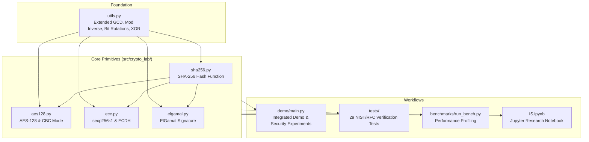
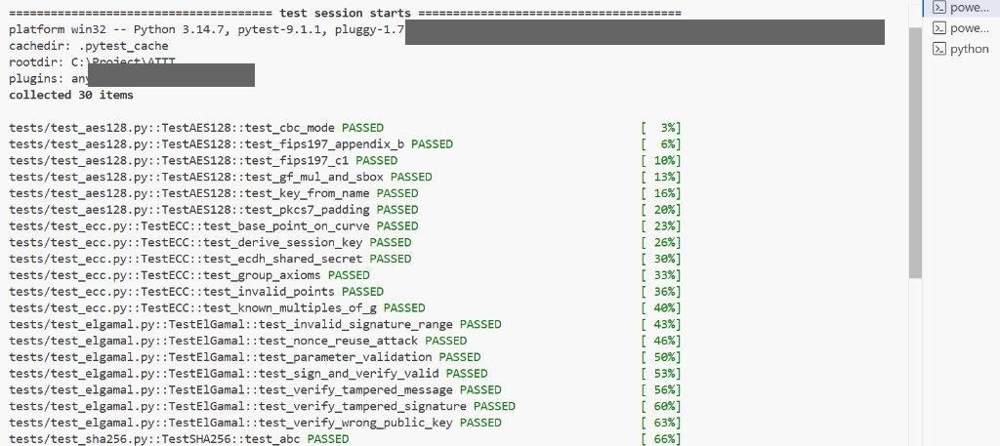
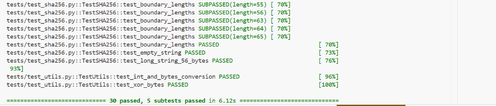
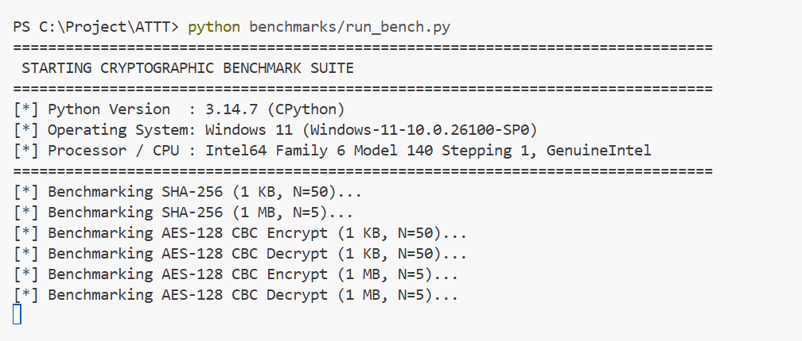
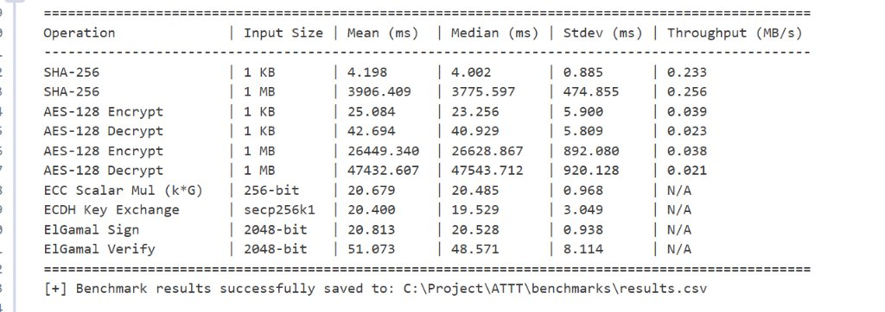
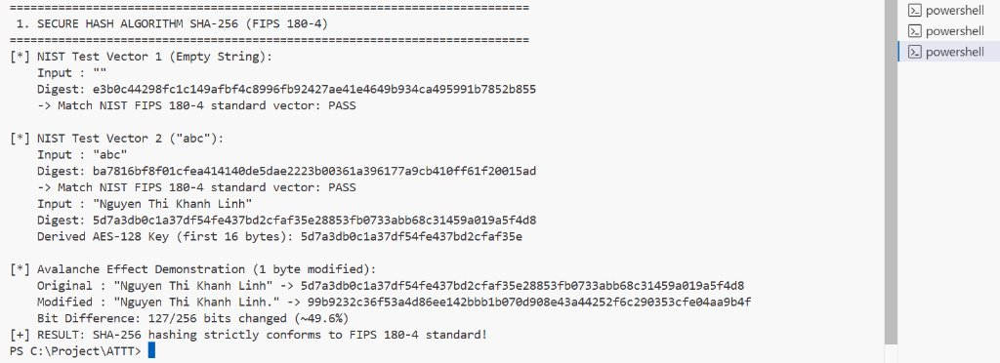
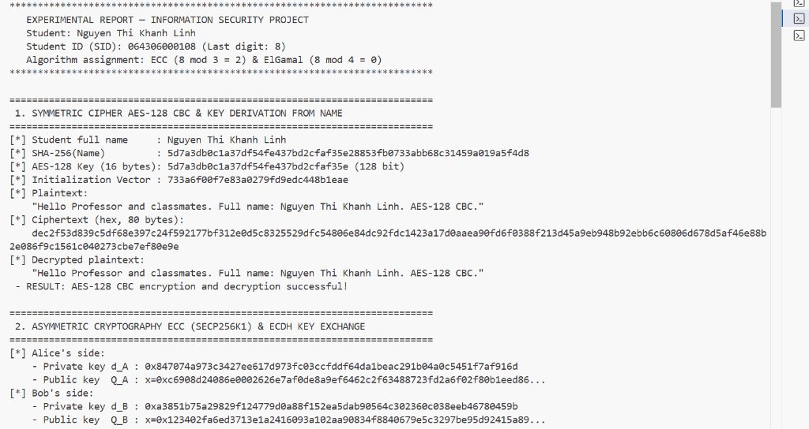
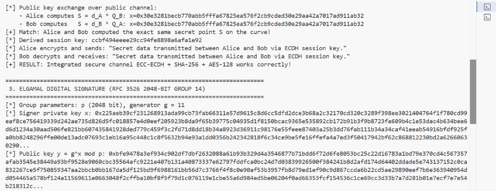
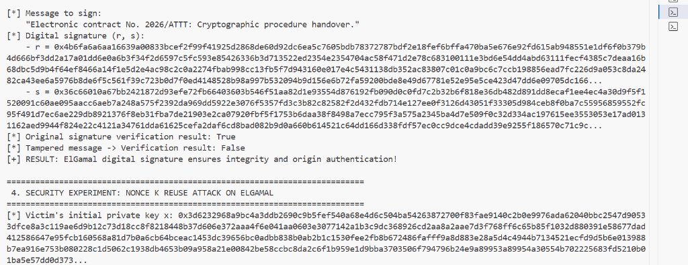
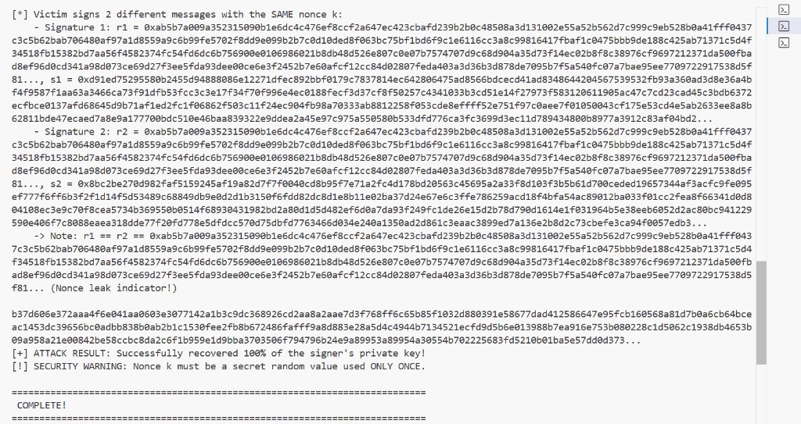

# Personal Project on Information Security: Implementation of Cryptographic Algorithms from First Principles

[](src/crypto_lab/__init__.py)
[](https://www.python.org/)
[](tests/)
[]()
[]()
[]()

- **Student ID (SID):** `064306xxxx08` (Last digit: `8`)
- **Assignment Distribution:**
  - $8 \pmod 3 = 2 \rightarrow$ **Elliptic Curve Cryptography (ECC / ECDH)**
  - $8 \pmod 4 = 0 \rightarrow$ **ElGamal Digital Signature**

---

## 1. Overview

This project provides a standalone, first-principles implementation of fundamental cryptographic primitives in pure Python. All algorithms are constructed directly from arithmetic and bit-level operations using solely the Python standard library—without third-party cryptographic frameworks (`cryptography`, `PyCryptodome`, `PyNaCl`) or built-in cryptographic wrappers (`hashlib`, `hmac`, `ssl`).

The implemented suite comprises:
1. **SHA-256** cryptographic hash function (FIPS 180-4).
2. **AES-128** symmetric block cipher in **CBC mode** with PKCS#7 padding (FIPS 197, NIST SP 800-38A).
3. **Elliptic Curve Cryptography (secp256k1)** and **ECDH Key Exchange** (SEC 2).
4. **ElGamal Digital Signature Scheme** over RFC 3526 Group 14 (2048-bit MODP safe prime).

---

## 2. Problem Statement

Most modern cryptographic libraries encapsulate algorithm implementations within compiled C/assembly binaries. While performant, this abstraction obscures underlying algebraic structures, finite-field transformations, and subtle implementation-specific attack surfaces. 

This project addresses this educational and investigative gap by:
- Implementing finite-field arithmetic ($\text{GF}(2^8)$ multiplication and affine curve point operations) from fundamental mathematical definitions.
- Tracing exact bitwise and byte-level state mutations across transformation rounds.
- Demonstrating protocol vulnerabilities through concrete proof-of-concept attacks, specifically private key recovery resulting from ephemeral nonce reuse in ElGamal signatures.

---

## 3. Features

### SHA-256 Hash Function (FIPS 180-4)
- Full 512-bit block message schedule expansion ($W_0 \dots W_{63}$).
- Compression function utilizing 8 state variables ($a \dots h$), 64 round constants ($K$), and standard bitwise logic ($\text{Ch}, \text{Maj}, \Sigma_0, \Sigma_1, \sigma_0, \sigma_1$).
- Standard big-endian bit-length padding for arbitrary input byte streams.
- Direct hexadecimal and raw byte output generation.

### AES-128 Block Cipher & CBC Mode (FIPS 197 & NIST SP 800-38A)
- Irreducible polynomial arithmetic over $\text{GF}(2^8)$ ($m(x) = x^8 + x^4 + x^3 + x + 1$).
- Dynamic S-box and inverse S-box mappings with affine transformations in $\text{GF}(2^8)$.
- 10-round cipher transformations: `SubBytes`, `ShiftRows`, `MixColumns`, and `AddRoundKey` (with corresponding inverse operations for decryption).
- Key expansion algorithm deriving 11 round keys (44 32-bit words) from a 128-bit master key.
- Cipher Block Chaining (CBC) mode with random 16-byte Initialization Vector (IV) generation.
- Strict PKCS#7 padding and unpadding with boundary invariant validation.
- Name-based key derivation using SHA-256.

### Elliptic Curve Cryptography & ECDH (SEC 2)
- Point arithmetic over the Koblitz curve $y^2 \equiv x^3 + 7 \pmod p$ with prime $p = 2^{256} - 2^{32} - 977$.
- Affine coordinate point addition, point doubling, and point-at-infinity handling.
- Double-and-add scalar multiplication algorithm ($k \cdot P$).
- Verification ensuring public points strictly satisfy the curve equation prior to group operations.
- Diffie-Hellman Key Exchange (ECDH) convergence to compute an identical shared secret point $S$.
- AES-128 session key derivation from the x-coordinate of the shared secret ($S.x$).

### ElGamal Digital Signature Scheme (RFC 3526 Group 14)
- 2048-bit safe prime $p$ ($p = 2q + 1$) and generator $g$ parameters.
- Keypair generation ($x, y = g^x \pmod p$) using cryptographically secure pseudorandom numbers (`secrets.randbits`).
- Digital signature generation $(r, s)$ with SHA-256 message digests.
- Signature verification confirming $g^{H(m)} \equiv y^r \cdot r^s \pmod p$.
- **Security Audit Experiment:** Full private key recovery attack when an ephemeral nonce $k$ is reused across two distinct signed messages.

---

## 4. Technology Stack

- **Language:** Python 3.10+ (tested on Python 3.10 through 3.14).
- **Core Standard Library Modules:**
  - `secrets`: Cryptographically secure pseudorandom number generator (CSPRNG) for keys, IVs, and nonces.
  - `unittest`: Automated unit test framework and NIST test vector validation.
  - `time`, `statistics`: High-resolution execution timing (`time.perf_counter`) and statistical profiling.
  - `csv`, `json`: Tabular benchmark data generation and structural serialization.
  - `struct`: 32-bit and 64-bit word packing/unpacking.
  - `pathlib`, `sys`, `os`: Path resolution and execution control.
- **External Dependencies:** **None** (zero third-party packages required for algorithm execution, tests, demo, or benchmarks).

---

## 5. System Architecture

The following diagram illustrates the interaction between foundational utility routines, core cryptographic primitives, and execution workflows:



### Module Dependency Matrix

| Module | Dependencies | Description |
|---|---|---|
| `crypto_lab.utils` | *(none)* | Modular arithmetic (`extended_gcd`, `mod_inverse`), 32-bit circular rotations, byte conversions |
| `crypto_lab.sha256` | `utils` | Bit rotations (`rotr32`), message schedule, compression loops |
| `crypto_lab.aes128` | `utils`, `sha256` | Finite-field $\text{GF}(2^8)$ multiplication, block transformations, CBC XOR chaining, name key derivation |
| `crypto_lab.ecc` | `utils`, `sha256` | Field inversion modulo prime $p$, point addition/doubling, scalar multiplication, ECDH agreement, session key derivation (`derive_session_key`) |
| `crypto_lab.elgamal` | `sha256`, `utils` | SHA-256 message hashing, modular inverse modulo $(p - 1)$, signature generation/verification, nonce attack |
| `demo/main.py` | All `crypto_lab` modules | End-to-end integration demo and attack demonstrations |
| `benchmarks/run_bench.py` | All `crypto_lab` modules | Statistical measurement of throughput, latency, and median across operations |

---

## 6. Project Structure

```
ATTT/
├── AI_usage.md               # Technical requirements, constraints, and project rules
├── IS.ipynb                  # Experimental analysis and documentation notebook
├── README.md                 # Project documentation and user manual (this file)
├── .gitignore                # Git ignore configuration
├── docs/                     # Detailed algorithm technical specifications and reports
│   ├── ai_usage_log.md       # Log of assistance, test vector verification, and quality audit
│   ├── aes128.md             # Technical specification & analysis of AES-128 CBC
│   ├── sha256.md             # Technical specification & analysis of SHA-256
│   ├── ecc.md                # Technical specification & analysis of secp256k1 & ECDH
│   └── elgamal.md            # Technical specification & analysis of ElGamal signatures
├── src/
│   └── crypto_lab/           # First-principles cryptographic algorithm library
│       ├── __init__.py       # Package initializer (exports __version__ = "1.0.0")
│       ├── utils.py          # Math, bitwise, and modular arithmetic utilities
│       ├── sha256.py         # SHA-256 implementation
│       ├── aes128.py         # AES-128 core and CBC mode implementation
│       ├── ecc.py            # secp256k1 curve parameters and ECDH protocol
│       └── elgamal.py        # 2048-bit ElGamal digital signature implementation
├── tests/                    # Automated unit test suite (30 tests)
│   ├── __init__.py
│   ├── test_utils.py         # Arithmetic and bitwise operation tests
│   ├── test_sha256.py        # NIST FIPS 180-4 test vectors
│   ├── test_aes128.py        # NIST FIPS 197 & SP 800-38A test vectors
│   ├── test_ecc.py           # SEC 2 curve validation and ECDH convergence tests
│   └── test_elgamal.py       # RFC 3526 signature verification and attack tests
├── demo/
│   └── main.py               # Integrated end-to-end executable demonstration
├── benchmarks/
│   ├── run_bench.py          # Benchmark runner measuring latency and throughput
│   └── results.csv           # Measured performance results
├── evidence/                 # Visual evidence and experiment logs
└── report/                   # Academic assignment reports
```

---

## 7. Requirements & Installation

### Requirements
- **Operating System:** Platform independent (Windows, Linux, macOS).
- **Python Version:** Python 3.10 or later (verified up to Python 3.14).
- **Environment:** Standard Python environment; no virtualenv or package installations are required.

### Installation
1. Clone the repository:
   ```bash
   git clone https://github.com/khanhlinh616/ATTT_Linh.git
   cd ATTT_Linh
   ```
2. Verify your Python environment:
   ```bash
   python --version
   ```

---

## 8. Configuration

This project is fully self-contained:
- **No external API keys or secrets** are needed.
- **No configuration files** require manual adjustment.
- Cryptographic parameters (such as the NIST secp256k1 curve parameters and RFC 3526 2048-bit MODP Group 14 safe prime) are defined as constants within their respective modules in `src/crypto_lab/`.

---

## 9. Usage

### 1. Running the Integrated Demo
Executes a sequential demonstration of all 4 modules, including key derivation from the student name, ECDH secure channel setup, ElGamal signing, and the private key recovery attack:
```bash
python demo/main.py
```

### 2. Running the Performance Benchmarks
Executes multi-iteration latency and throughput measurements across all primitives, updating `benchmarks/results.csv`:
```bash
python benchmarks/run_bench.py
```

### 3. Running the Unit Tests
Executes the full test suite verifying compliance with official NIST and RFC standards:
```bash
python -m unittest discover -s tests
```

---

## 10. Concrete Input/Output Examples

The following examples reflect actual outputs generated by `demo/main.py`:

### AES-128 CBC Encryption & Decryption
```text
[*] Student Identifier    : [PROTECTED / ANONYMIZED] (Last digit: 8)
[*] SHA-256(Identifier)   : 5d7a3db0c1a37df54fe437bd2cfaf35e28853fb0733abb68c31459a019a5f4d8
[*] AES-128 Key (16 bytes): 5d7a3db0c1a37df54fe437bd2cfaf35e (128 bit)
[*] Initialization Vector : 9e00a8d6bb25ef11a460389a60f94874
[*] Plaintext             : "Hello Professor and classmates. AES-128 CBC."
[*] Ciphertext (hex, 80B) : 421c6573eb67099f49605431f26bc609a61214d5d381c32da53d3678d4695182...
[*] Decrypted plaintext   : "Hello Professor and classmates. AES-128 CBC."
[+] Result                : Plaintext matches decrypted text exactly.
```

### ECDH Key Agreement & Channel Encryption
```text
[*] Alice private key d_A : 0x28d6...[PROTECTED_PRIVATE_KEY]...e8e8
[*] Bob private key d_B   : 0xb14c...[PROTECTED_PRIVATE_KEY]...ffff
[*] Alice computes S      : x=0x63411ca967041a26d3d6cae10747168c220a10a7a969bb1c6c48d1778c8255b4
[*] Bob computes S        : x=0x63411ca967041a26d3d6cae10747168c220a10a7a969bb1c6c48d1778c8255b4
[+] Agreement Match       : Both parties arrived at the exact same elliptic curve point.
[*] Derived AES Session Key: 47f42a640ce72632fcbd513fc32dfc34 (first 16 bytes of SHA-256(S.x))
```

### ElGamal Signature & Tamper Detection
```text
[*] Message to sign       : "Electronic contract No. 2026/ATTT: Cryptographic procedure handover."
[*] Signature (r, s)      : r = 0x5c8ec64f..., s = 0x193eecf9... (each 2048-bit integer)
[*] Verification (valid)  : True
[*] Verification (tampered): False (modification of 1 byte triggers immediate verification failure)
```

### Nonce Reuse Private Key Recovery Attack
When signer uses the identical ephemeral nonce $k$ for two distinct messages $m_1$ and $m_2$:
$$\Delta s = s_1 - s_2 \equiv k^{-1} (H(m_1) - H(m_2)) \pmod{p - 1}$$
$$k \equiv \Delta s^{-1} (H(m_1) - H(m_2)) \pmod{p - 1}$$
$$x \equiv r^{-1} (H(m_1) - k \cdot s_1) \pmod{p - 1}$$
```text
[*] Signer original private key: 0xc8ea...[PROTECTED_PRIVATE_KEY]...9d5e
[*] Nonce collision observed   : r1 == r2 == 0xab5b7a009a...
[*] Recovered private key      : 0xc8ea...[PROTECTED_PRIVATE_KEY]...9d5e
[+] Attack Result              : 100% private key recovery confirmed.
```

---

## 11. Testing

The project incorporates an automated test suite executed via `unittest`:

```bash
# Run the complete test suite
python -m unittest discover -s tests

# Run specific test suites
python -m unittest tests/test_sha256.py
python -m unittest tests/test_aes128.py
python -m unittest tests/test_ecc.py
python -m unittest tests/test_elgamal.py
python -m unittest tests/test_utils.py
```

### Test Suite Verification Matrix

| Test Suite | Test Count | Scope & Standards Verified | Status |
|---|---|---|---|
| `test_sha256.py` | 7 | NIST FIPS 180-4 test vectors (empty string, `"abc"`, 56-byte message, 1,000,000 `'a'` characters), boundary conditions (55, 56, 63, 64, 65 bytes), input validation | **PASS** |
| `test_aes128.py` | 6 | FIPS 197 Appendix B & C.1 vectors, NIST SP 800-38A Section F.2.1 CBC vector, $\text{GF}(2^8)$ multiplication, S-box tables, PKCS#7 padding validation | **PASS** |
| `test_ecc.py` | 6 | Base point $G$ order, SEC 2 standard reference points ($2G, 3G, 7G$), Abelian group axioms, off-curve and coordinate bound rejection, 20-pair random ECDH convergence, session key derivation (`derive_session_key`) | **PASS** |
| `test_elgamal.py` | 7 | RFC 3526 Group 14 parameters, signature validity, tampered message rejection, tampered signature rejection, wrong public key rejection, range checks, $s=0$ rejection, nonce recovery attack | **PASS** |
| `test_utils.py` | 4 | 32-bit circular rotations, integer-to-bytes endianness conversion, Extended Euclidean Algorithm / modular inverse, byte XOR operations | **PASS** |
| **Total** | **30** | **Full algorithm correctness and standard compliance** | **30/30 PASS** |

**Test Execution Evidence (`python -m pytest tests/ -v`):**





---

## 12. Benchmark Results

Performance evaluation conducted across 50 iterations (1 KB / 256-bit / 2048-bit inputs) and 5 iterations (1 MB inputs) via `benchmarks/run_bench.py` on Windows 11 (Python 3.14.7, Intel64):

| Operation | Input / Key Size | Iterations | Mean Latency (ms) | Median (ms) | Std Dev (ms) | Throughput (MB/s) |
|---|---|---|---|---|---|---|
| **SHA-256** | 1 KB | 50 | 15.837 | 11.827 | 10.957 | 0.062 |
| **SHA-256** | 1 MB | 5 | 4,202.108 | 3,909.468 | 740.506 | 0.238 |
| **AES-128 Encrypt** | 1 KB | 50 | 23.011 | 22.147 | 3.401 | 0.042 |
| **AES-128 Decrypt** | 1 KB | 50 | 49.603 | 49.454 | 6.365 | 0.020 |
| **AES-128 Encrypt** | 1 MB | 5 | 28,015.730 | 29,155.478 | 2,362.632 | 0.036 |
| **AES-128 Decrypt** | 1 MB | 5 | 74,041.505 | 77,596.833 | 5,889.131 | 0.014 |
| **ECC Scalar Mul ($k \cdot G$)** | 256-bit | 50 | 37.150 | 34.825 | 10.918 | N/A |
| **ECDH Key Exchange** | secp256k1 | 50 | 39.145 | 36.414 | 8.867 | N/A |
| **ElGamal Sign** | 2048-bit | 50 | 62.999 | 50.519 | 69.158 | N/A |
| **ElGamal Verify** | 2048-bit | 50 | 84.717 | 89.341 | 19.391 | N/A |

### Observations:
- **AES-128 Asymmetry:** Decryption is ~2.1x slower than encryption because `InvMixColumns` requires Galois field multiplication by $\{0e, 0b, 0d, 09\}$ (decimal 14, 11, 13, 9), whereas forward `MixColumns` uses simpler coefficients $\{02, 03, 01, 01\}$ (`xtimes`).
- **ECDH Equivalence:** ECDH key exchange (~39.15 ms) is computationally equivalent to a single scalar multiplication (~37.15 ms) plus initial point validation.

**Benchmark Execution Evidence (`python benchmarks/run_bench.py`):**





**Demo Execution Evidence (`python demo/main.py`):**











---

## 13. Limitations

1. **Performance & Hardware Acceleration:**
   As a pure Python implementation designed for conceptual clarity, code execution relies on standard interpreted Python bytecode without native C extensions, SIMD, or hardware-accelerated instructions (such as AES-NI or SHA Extensions).
2. **Side-Channel Timing Susceptibility:**
   Python's dynamic memory allocation and standard branch execution do not guarantee constant-time operation. This implementation is vulnerable to cache-timing and execution-timing analysis, and is intended strictly for research and academic study.
3. **CSPRNG Nonce Discipline:**
   The security of ElGamal signatures depends entirely on the non-repetition of the ephemeral nonce $k$. As demonstrated in Section 10, any failure of the randomness source leading to nonce reuse allows instant algebraic recovery of the signer's private key.

---

## 14. References

1. **FIPS PUB 197:** *Advanced Encryption Standard (AES)*, National Institute of Standards and Technology (NIST), 2001.
2. **NIST SP 800-38A:** *Recommendation for Block Cipher Modes of Operation: Methods and Techniques*, NIST, 2001.
3. **FIPS PUB 180-4:** *Secure Hash Standard (SHS)*, National Institute of Standards and Technology (NIST), 2015.
4. **SEC 2 (v2.0):** *Recommended Elliptic Curve Domain Parameters*, Standards for Efficient Cryptography Group (SECG), 2010.
5. **RFC 3526:** *More Modular Exponential (MODP) Diffie-Hellman groups for Internet Key Exchange (IKE)*, Internet Engineering Task Force (IETF), 2003.
6. **ElGamal, T. (1985):** *"A Public Key Cryptosystem and a Signature Scheme Based on Discrete Logarithms"*, IEEE Transactions on Information Theory, 31(4), 469–472.
