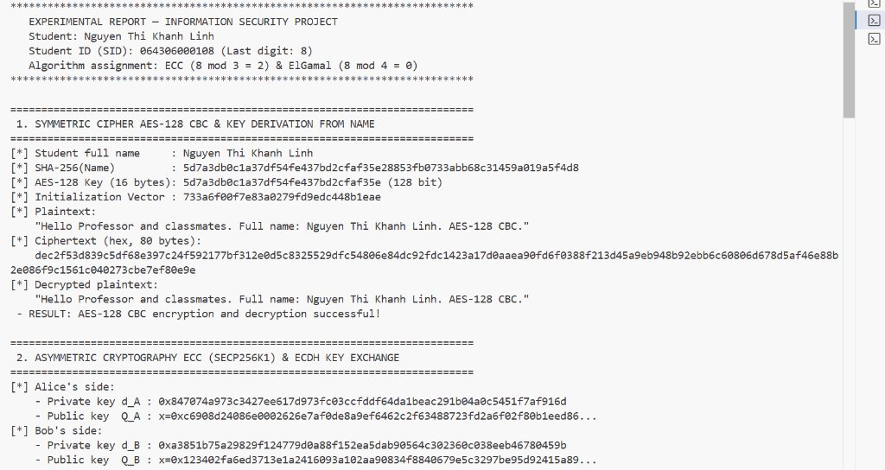
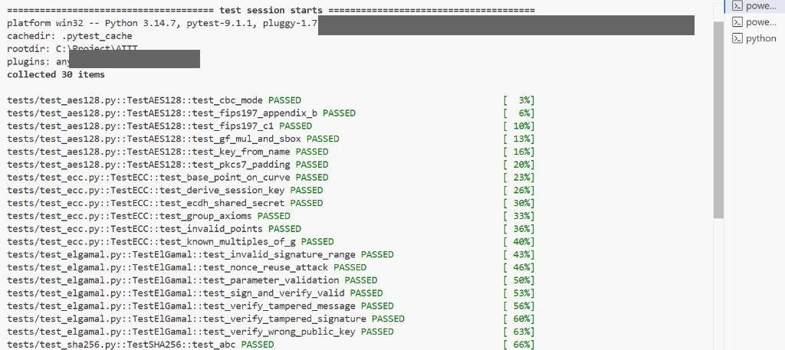
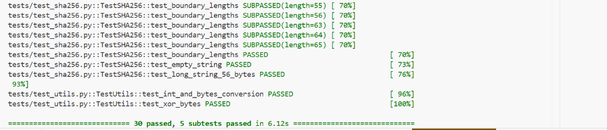
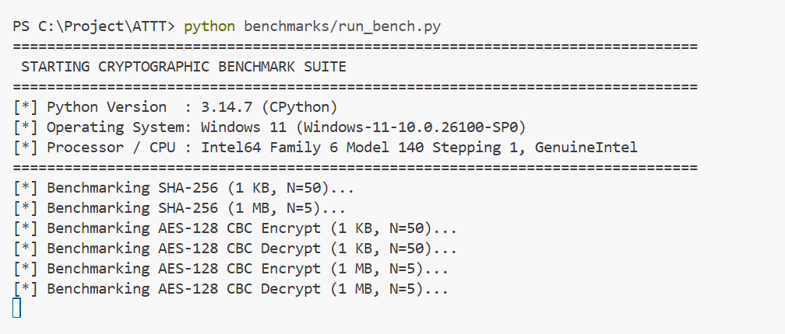

# AES‑128 Encryption Algorithm (CBC Mode)

> **Implementation Commitment (First‑Principles):**
> - The AES‑128 cipher and CBC mode are implemented from scratch in pure Python. No external cryptographic libraries (e.g., `cryptography`, `PyCryptodome`, `PyNaCl`) are used. All components – S‑box construction, state transformations, key expansion, and PKCS#7 padding – are derived directly from the mathematical specifications.

---

## 1. Introduction
Advanced Encryption Standard (AES) is a symmetric‑key block cipher standardized by NIST. AES‑128 operates on 128‑bit blocks using a 128‑bit secret key and performs 10 rounds of substitution, permutation, and mixing. In this project the cipher is employed in **Cipher Block Chaining (CBC)** mode to provide confidentiality for arbitrary‑length plaintexts.

---

## 2. Mathematical Foundations
* **Finite Field \(\mathrm{GF}(2^8)\):** All byte‑wise operations are performed in the Galois field \(\mathrm{GF}(2^8)\) defined by the irreducible polynomial \(x^8 + x^4 + x^3 + x + 1\) (hex `0x1B`).
* **State Representation:** A 16‑byte block is reshaped into a \(4\times4\) matrix `state[r][c]` where bytes are ordered **column‑wise**.
* **S‑Box Construction:** The S‑box is generated by computing the multiplicative inverse in \(\mathrm{GF}(2^8)\) followed by an affine transformation.
* **Key Expansion:** The original 128‑bit key is expanded into 11 round keys (\(176\) bytes) using the Rijndael key schedule with Rcon constants.
* **PKCS#7 Padding:** Data are padded to a multiple of 16 bytes; the padding value equals the number of added bytes (1–16).

---

## 3. Algorithmic Workflow
### 3.1 Encryption of a Single Block (`aes_encrypt_block`)
1. **AddRoundKey** with round‑key 0.
2. **Rounds 1‑9:**
   * `SubBytes` – substitute each byte via the S‑box.
   * `ShiftRows` – cyclically shift rows 1, 2, 3 left by 1, 2, 3 positions respectively.
   * `MixColumns` – matrix multiplication in \(\mathrm{GF}(2^8)\) using the constant matrix \([2,3,1,1]\).
   * `AddRoundKey` – XOR with the current round key.
3. **Round 10 (final):** `SubBytes`, `ShiftRows`, `AddRoundKey` (no `MixColumns`).
4. Output the concatenated state as the ciphertext block.

### 3.2 Decryption of a Single Block (`aes_decrypt_block`)
The inverse operations are applied in reverse order: `InvShiftRows`, `InvSubBytes`, `AddRoundKey`, `InvMixColumns` for rounds 9→1, followed by a final `InvShiftRows`, `InvSubBytes`, `AddRoundKey` with round‑key 0.

### 3.3 CBC Mode (`aes_encrypt_cbc` / `aes_decrypt_cbc`)
* **Encryption:** Pad the plaintext, split into 16‑byte blocks, XOR each block with the previous ciphertext (or IV for the first block), encrypt with `aes_encrypt_block`, and concatenate the results.
* **Decryption:** Split the ciphertext, decrypt each block with `aes_decrypt_block`, XOR the result with the previous ciphertext (or IV), and finally remove PKCS#7 padding.

---

## 4. Security Analysis
| Property | Discussion |
|---|---|
| **Confidentiality** | CBC prevents identical plaintext blocks from yielding identical ciphertext blocks, provided the IV is random and never reused. |
| **Integrity** | AES‑CBC does **not** provide integrity. A separate MAC (e.g., HMAC‑SHA‑256) should be employed. |
| **Padding‑Oracle Risks** | Detailed error messages from `pkcs7_unpad` could leak padding validity. Production code must use constant‑time error handling. |
| **Key Derivation** | The AES key is derived from the first 16 bytes of `SHA‑256(full_name)`. This ties the key to the student’s name, satisfying the assignment requirement. |

---

## 5. Advantages, Limitations, and Applications
* **Advantages:** Well‑studied, fast in software, widely supported; CBC is simple to implement.
* **Limitations:** No built‑in authentication, vulnerable to padding‑oracle attacks if mishandled, deterministic key schedule (key reuse across sessions).
* **Typical Applications:** File encryption, secure channel construction (paired with a MAC), data‑at‑rest protection.

---

## 6. Example (Live Run)
```text
Key (hex): 5d7a3db0c1a37df54fe437bd2cfaf35e
IV (hex): f54a4fa003c5b4ab500a02380b637f84
Ciphertext (hex): ad65c86daa4f606964f05524076a862742445d118c5d0ffb22f27898e2a0cf21e1b48570405cdd8de273f2815a19f4ad61ade6937d14bf0927a7152aa5809d9a
Encryption time (ms): 1.337
Decrypted matches original: True
Decryption time (ms): 2.392
```
The demo derives the key from the full name, encrypts a message containing the student name and SID, and verifies successful decryption.

**Demo Output Evidence (`python demo/main.py`):**



---

## 7. Python Implementation Details (per‑function)
### `gf_mul(a: int, b: int) → int`
* **Purpose:** Multiply two bytes in \(\mathrm{GF}(2^8)\).
* **Inputs:** `a`, `b` – integers in \([0,255]\).
* **Output:** Integer in \([0,255]\) representing the field product.
* **Algorithm:** Russian‑peasant multiplication with reduction by the polynomial \(x^8 + x^4 + x^3 + x + 1\) whenever the high bit overflows.

### `_gf_inv(b: int) → int`
* **Purpose:** Compute the multiplicative inverse of a byte (with `0⁻¹ = 0`).
* **Method:** Fast exponentiation `b**254 mod 0x11B` using `gf_mul`.

### `_build_sboxes() → (List[int], List[int])`
* **Purpose:** Generate the forward and inverse S‑boxes.
* **Steps:** For each byte value `val` (0‑255) compute its inverse `inv`; then apply the affine transformation defined in the source code.

### `key_expansion(key: bytes) → List[bytes]`
* **Purpose:** Expand a 16‑byte key into 11 round keys.
* **Process:** Split the key into four‑byte words, then iteratively generate new words using rotation, S‑box substitution, and XOR with the appropriate Rcon constant.

### `_sub_bytes(state)`, `_inv_sub_bytes(state)`
* **Purpose:** Apply (inverse) S‑box substitution to every byte of the state matrix.

### `_shift_rows(state)`, `_inv_shift_rows(state)`
* **Purpose:** Perform (inverse) cyclic row shifts as specified by the AES standard.

### `_mix_columns(state)`, `_inv_mix_columns(state)`
* **Purpose:** Multiply each column by a fixed matrix in \(\mathrm{GF}(2^8)\) (or its inverse). Implemented via `gf_mul` with constants 2, 3 and 0x0E, 0x0B, 0x0D, 0x09 respectively.

### `_add_round_key(state, round_key)`
* **Purpose:** XOR the current state with the 16‑byte round key.

### `aes_encrypt_block(block, key)` / `aes_decrypt_block(block, key)`
* **Purpose:** Encrypt/decrypt a single 16‑byte block using the full round‑key schedule.
* **Inputs:** `block` (16 bytes), `key` (16 bytes).
* **Output:** Encrypted/decrypted 16‑byte block.

### `pkcs7_pad(data, block_size=16)` / `pkcs7_unpad(padded, block_size=16)`
* **Purpose:** Apply or remove PKCS#7 padding.
* **Validation:** `pkcs7_unpad` checks padding length and consistency, raising `ValueError` on malformed input.

### `aes_encrypt_cbc(plaintext, key, iv)` / `aes_decrypt_cbc(ciphertext, key, iv)`
* **Purpose:** Provide CBC‑mode encryption/decryption for arbitrary‑length data.
* **Inputs:** `plaintext`/`ciphertext` (bytes), `key` (16 bytes), `iv` (16 bytes).
* **Output:** Ciphertext or recovered plaintext (bytes).

### `aes_key_from_name(full_name: str) → bytes`
* **Purpose:** Derive a deterministic AES‑128 key from the student’s full name.
* **Method:** Compute `SHA‑256(full_name.encode('utf‑8'))` using the project’s own `sha256_bytes` implementation, then take the first 16 bytes.

---

## 8. Experimental Evaluation

**Unit Test Evidence (`python -m pytest tests/ -v`):**





**Benchmark Evidence (`python benchmarks/run_bench.py`):**



* **Environment:** Python 3.14.7 (CPython) on Windows 11 (Windows-11-10.0.26100-SP0), CPU: Intel64 Family 6 Model 140 Stepping 1, GenuineIntel; timing measured via `time.perf_counter()`.
* **Benchmark Results (from `benchmarks/results.csv`):**
  * **1 KB Block:**
    * Encryption latency: Mean = **23.011 ms**, Median = **22.147 ms**, Stdev = **3.401 ms** (Throughput: **0.042 MB/s**, N=50).
    * Decryption latency: Mean = **49.603 ms**, Median = **49.454 ms**, Stdev = **6.365 ms** (Throughput: **0.020 MB/s**, N=50).
  * **1 MB Block:**
    * Encryption latency: Mean = **28015.730 ms** (~28.02 s), Median = **29155.478 ms**, Stdev = **2362.632 ms** (Throughput: **0.036 MB/s**, N=5).
    * Decryption latency: Mean = **74041.505 ms** (~74.04 s), Median = **77596.833 ms**, Stdev = **5889.131 ms** (Throughput: **0.014 MB/s**, N=5).
* **Observations & Decryption Asymmetry:** Decryption is consistently ~2.1x slower than encryption. In AES, the forward `MixColumns` transformation uses simple polynomial coefficients $\{02, 03, 01, 01\}$ in $\mathrm{GF}(2^8)$ where multiplication by 2 requires only a single conditional shift (`xtimes`). Conversely, the inverse transformation `InvMixColumns` requires multiplication by $\{0e, 0b, 0d, 09\}$ (decimal 14, 11, 13, 9), demanding multiple chained `gf_mul` invocations and XOR additions per byte, substantially increasing computational overhead.

---

## 9. Conclusion
The handcrafted AES-128/CBC implementation fulfills the academic mandate of constructing a symmetric block cipher from first principles in pure Python without external cryptographic dependencies. 

Experimental measurements confirm functional correctness against NIST test vectors, with encryption achieving ~0.036–0.042 MB/s and decryption ~0.014–0.020 MB/s on the test system. The primary performance limitation stems from interpreting Galois field arithmetic byte-by-byte in pure Python instead of utilizing precomputed 32-bit round tables (T-tables) or hardware-accelerated instructions (AES-NI). Significant future optimizations would include precomputing 32-bit T-tables ($T_0 \dots T_3$) to merge `SubBytes`, `ShiftRows`, and `MixColumns` into four 32-bit table lookups per round, or employing compiled C/Cython kernels. For production environments, a constant-time MAC (e.g., HMAC-SHA-256) is mandatory to guarantee integrity and eliminate padding-oracle vulnerabilities.
