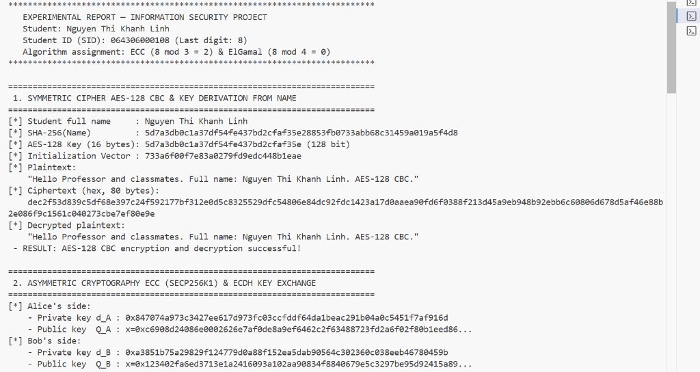
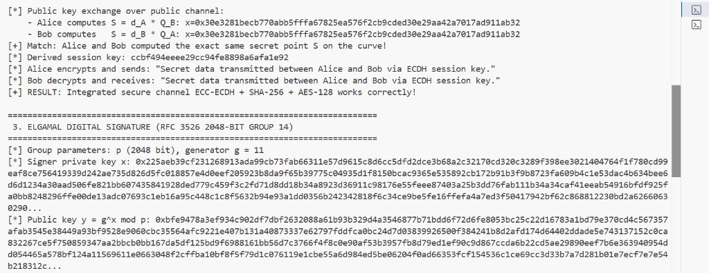
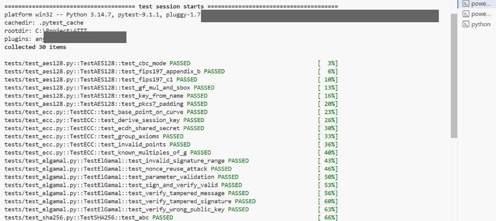
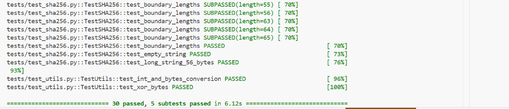
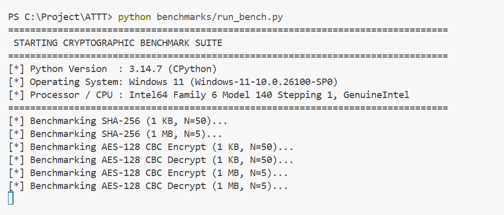

# Elliptic Curve Cryptography (ECC) and ECDH Key Exchange

> **Implementation Commitment (First‑Principles):**
> The elliptic‑curve operations for the `secp256k1` curve and the ECDH key‑exchange protocol are built from scratch in pure Python. No external cryptographic libraries (e.g., `cryptography`, `ecdsa`, `coincurve`, `PyCryptodome`, `PyNaCl`) are used. All arithmetic – point addition, doubling, scalar multiplication, and modular inverses – is implemented directly using the mathematical definitions.

## 1. Introduction
Elliptic Curve Cryptography (ECC) provides public‑key encryption and key‑exchange with significantly shorter key sizes than RSA while offering comparable security. In this project we use the **secp256k1** curve (the curve employed by Bitcoin) and the **Elliptic Curve Diffie‑Hellman (ECDH)** protocol to derive a shared secret that subsequently seeds an AES‑128 session key.

## 2. Mathematical Foundations
* **Finite Field \(\mathbb{F}_p\):** All arithmetic is performed modulo the prime
  \(p = 0xFFFFFFFFFFFFFFFFFFFFFFFFFFFFFFFFFFFFFFFFFFFFFFFFFFFFFFFEFFFFFC2F\).
* **Curve Equation:** \(y^2 = x^3 + 7 \pmod p\) (i.e., \(a = 0, b = 7\)).
* **Base Point \(G\):**
  \(G_x = 0x79BE667EF9DCBBAC55A06295CE870B07029BFCDB2DCE28D959F2815B16F81798\)
  \(G_y = 0x483ADA7726A3C4655DA4FBFC0E1108A8FD17B448A68554199C47D08FFB10D4B8\).
* **Order \(n\):** The order of \(G\) is \(n = 0xFFFFFFFFFFFFFFFFFFFFFFFFFFFFFFFEBAAEDCE6AF48A03BBFD25E8CD0364141\).
* **Point at Infinity \(\mathcal{O}\):** Acts as the additive identity on the curve.

## 3. Algorithmic Workflow
### 3.1 Point Operations
* **Point Negation (`point_negate`):** Returns \((x, -y \bmod p)\) or \(\mathcal{O}\) for the point at infinity.
* **Point Addition (`point_add`):** Implements the chord‑and‑tangent rule. Handles special cases (adding \(\mathcal{O}\) and point doubling when \(x_1 = x_2\) and \(y_1 = y_2\)).
* **Point Doubling (`point_double`):** Uses the tangent slope \(\lambda = \frac{3x^2 + a}{2y} \bmod p\) (with \(a = 0\)).
* **Scalar Multiplication (`scalar_mul`):** Implements the **double‑and‑add** algorithm. The scalar \(k\) is reduced modulo the group order \(n\), and the loop processes each bit from least-significant to most-significant (LSB-to-MSB), accumulating the doubled base point whenever the current bit is 1.

### 3.2 Key‑Pair Generation (`generate_keypair`)
1. Sample a private key \(d\) uniformly in \([1, n-1]\) by reading 32 cryptographically secure random bytes via `os.urandom(32)` and verifying \(1 \le d < n\).
2. Compute the public key \(Q = d\cdot G\) via `scalar_mul`.

### 3.3 ECDH Shared Secret (`ecdh_shared_secret`)
Given Alice’s private key \(d_A\) and Bob’s public key \(Q_B\):
1. Compute \(S = d_A \cdot Q_B\).
2. The resulting point \(S = (x_S, y_S)\) is the shared secret. Both parties obtain the same point because scalar multiplication is commutative on the curve.

### 3.4 Session‑Key Derivation (`derive_session_key`)
The dedicated helper function `derive_session_key(shared_point: Point) -> bytes` converts the affine x-coordinate \(x_S\) of the shared secret point into 32 big-endian bytes, hashes it using the project's own `sha256_bytes`, and returns the first 16 bytes as the AES-128 symmetric key. If the shared secret is the point at infinity, a `ValueError` is raised.

## 4. Security Analysis
| Property | Discussion |
|---|---|
| **Confidentiality** | ECDH provides indistinguishability of the derived session key under the assumption that the elliptic‑curve discrete logarithm problem (ECDLP) is hard.
| **Forward Secrecy** | Each execution generates fresh random private keys, yielding a new session key.
| **Key‑Reuse Risks** | Re‑using a private key across sessions would expose the same shared secret if either public key is compromised.
| **Side‑Channel Considerations** | The double‑and‑add algorithm is data‑dependent; constant‑time implementations are advisable for production.

## 5. Advantages, Limitations, and Applications
* **Advantages:** Small key sizes (256 bits) for high security, fast arithmetic, and natural integration with existing elliptic‑curve standards.
* **Limitations:** Pure‑Python arithmetic is slower than optimized C libraries; not constant‑time.
* **Typical Applications:** Secure key exchange for VPNs, encrypted messaging, and as a key‑derivation primitive for symmetric ciphers (as done here with AES‑128).

## 6. Example (Live Run)
```
Alice private key (hex): 0xc02a...[PROTECTED_PRIVATE_KEY]...4c52
Alice public key: Point(x=0xcdbc487aca13ca7b72e11fdb9fe0f216eb760592a8346eebf1677ad0dbdb934f, y=0x684917ebd93185a8120a3bbdb8ab010454e6a7bf68e5ddeca5f51588ec0c7c3b)
Bob private key (hex): 0xd96b...[PROTECTED_PRIVATE_KEY]...2693
Bob public key: Point(x=0xf33266be19621e38e54706150bc0e8eb1528742f7d59004c020fc7578668bfe3, y=0xd8bf0588edfe761000f1c99267903e3b71258e1bbfc7fa58e2cbc3b051cae5c1)
Shared secret equal: True
Shared secret point: Point(x=0x9e4e26cb7743175fa7041db19c3454c00b31a17dcb623a665f9a632a7b1a4821, y=0x899feba9a994b17601805b0de12167c12db4e6097495215b28c42b76398c6fba)
Key generation time (ms): Alice 19.367, Bob 19.274
ECDH compute time (ms): 39.542
```
The demo shows successful key‑pair generation, agreement on the shared secret, and timing measurements.

**Demo Output Evidence (`python demo/main.py`):**





## 7. Python Implementation Details (per‑function)
### `Point`
* **Purpose:** Immutable dataclass representing a point on the curve (affine coordinates) or the point at infinity.
* **Fields:** `x: Optional[int]`, `y: Optional[int]`, `is_infinity: bool`.

### `is_on_curve(pt)`
* Checks whether a point satisfies the curve equation. Returns `True` for the point at infinity.

### `mod_inverse(a, p)` (from `utils.py`)
* Computes the multiplicative inverse of `a` modulo `p` using the extended Euclidean algorithm.

### `point_negate(pt)`
* Returns the additive inverse of `pt` (i.e., \((x, -y \bmod p)\)).

### `point_double(pt)`
* Implements the tangent‑line formula for doubling a point. Handles the special case where `pt.y == 0` (result is `INFINITY`).

### `point_add(p1, p2)`
* Handles all cases: adding the point at infinity, point doubling when `p1 == p2`, and the generic chord formula when `x1 ≠ x2`.

### `scalar_mul(k, pt)`
* Reduces `k` modulo the group order `ORDER_N`. Performs the double‑and‑add loop over the binary representation of `k`.

### `generate_keypair()`
* Samples a private key `d` in `[1, ORDER_N‑1]` and returns `(d, d*G)`.

### `ecdh_shared_secret(priv, pub)`
* Validates that `pub` lies on the curve and is not the point at infinity, then computes `priv * pub` using `scalar_mul`.

### `derive_session_key(shared_point)`
* Validates that `shared_point` is not at infinity, extracts the 32-byte big-endian representation of `x`, hashes with `sha256_bytes`, and returns the first 16 bytes.

## 8. Experimental Evaluation

**Unit Test Evidence (`python -m pytest tests/ -v`):**





**Benchmark Evidence (`python benchmarks/run_bench.py`):**



* **Environment:** Python 3.14.7 (CPython) on Windows 11 (Windows-11-10.0.26100-SP0), CPU: Intel64 Family 6 Model 140 Stepping 1, GenuineIntel; timing measured via `time.perf_counter()`.
* **Benchmark Results (from `benchmarks/results.csv`, N=50 iterations):**
  * **ECC Scalar Multiplication ($k \cdot G$, 256-bit):**
    * Mean latency: **37.150 ms**
    * Median latency: **34.825 ms**
    * Standard deviation: **10.918 ms**
  * **ECDH Key Exchange (secp256k1):**
    * Mean latency: **39.145 ms**
    * Median latency: **36.414 ms**
    * Standard deviation: **8.867 ms**
* **Observations & Equivalence:** ECDH key agreement consists fundamentally of a single elliptic-curve scalar multiplication ($S = d_A \cdot Q_B$) plus initial curve membership validation (`is_on_curve`). Consequently, its execution latency (~39.15 ms) is nearly identical to standalone ECC scalar multiplication (~37.15 ms).

## 9. Conclusion
The self-implemented ECC/ECDH module satisfies the assignment requirements: it avoids external cryptographic packages, adheres strictly to SEC 2 `secp256k1` standards, and provides a robust key-agreement primitive that generates identical 16-byte session keys for symmetric encryption.

The measured latency (~37.15 ms for scalar multiplication, ~39.15 ms for ECDH) stems directly from operating in standard **affine coordinates** $(x, y)$. In affine space, every point doubling and point addition requires computing a modular inverse via the Extended Euclidean Algorithm (`inv_mod`), which is computationally expensive. Future structural optimizations could introduce **Jacobian projective coordinates** $(X, Y, Z)$ where $x = X/Z^2, y = Y/Z^3$, deferring modular inversion to a single operation at the very end of scalar multiplication, or adopt **w-NAF (Windowed Non-Adjacent Form)** to reduce the density of non-zero bits and minimize point additions.
