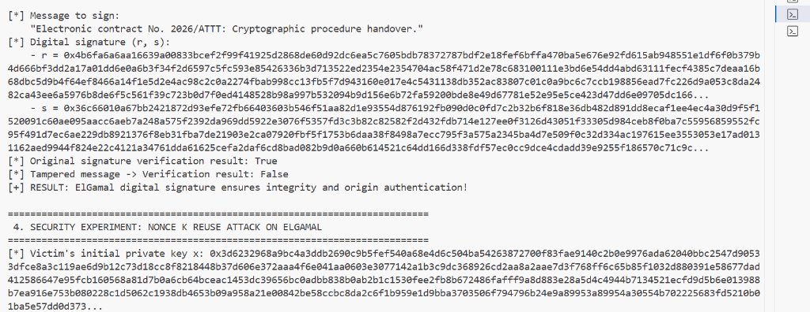
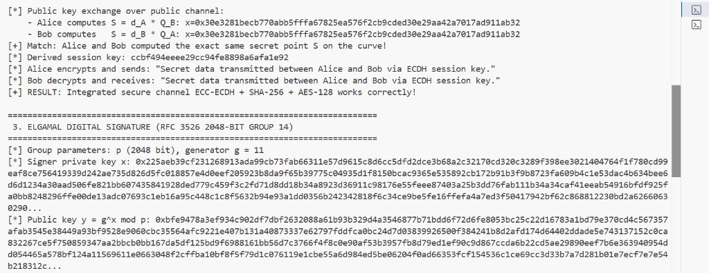
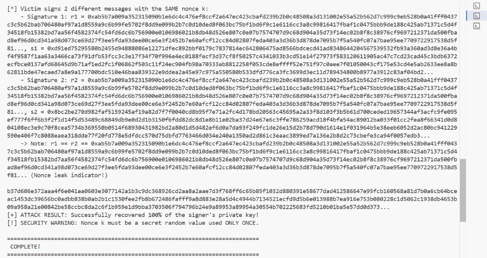
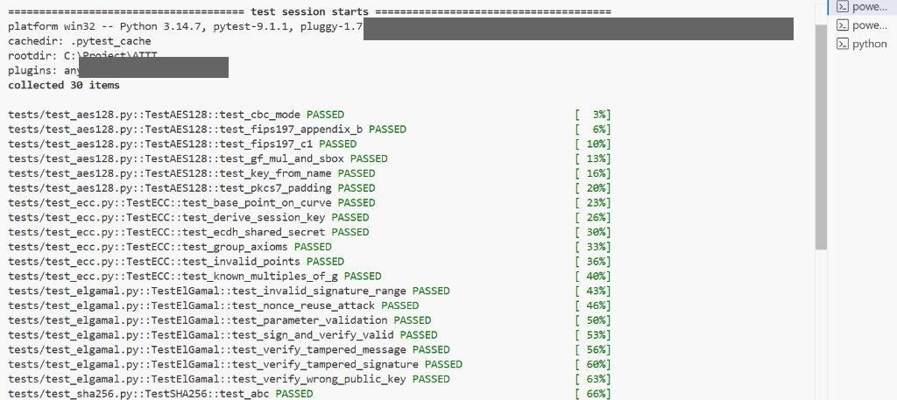
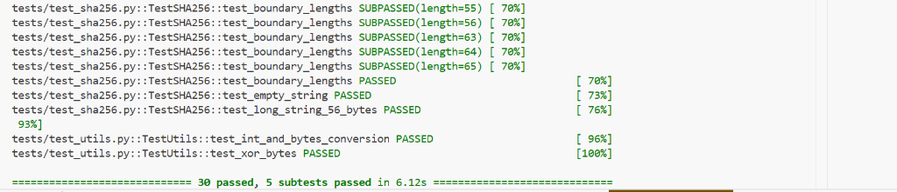
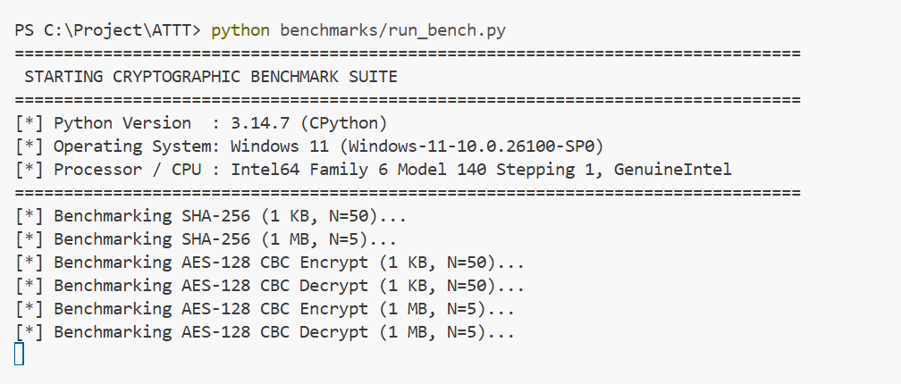

# ElGamal Digital Signature Scheme & Nonce‑Reuse Vulnerability (RFC 3526)

## 1. Introduction
Digital signatures provide **authentication, integrity, and non‑repudiation** for electronic documents. Unlike handwritten signatures, a cryptographic signature is a mathematically generated number pair that can be verified by anyone holding the signer's public key. In this project the ElGamal signature scheme is implemented from first principles on a 2048‑bit safe‑prime group (RFC 3526 Group 14) and is used to sign contract texts.

## 2. Mathematical Foundations
The scheme works in the multiplicative group \(\mathbb{Z}_p^*\) where:
- **Prime modulus \(p\):** a 2048‑bit safe prime (\(p = 2q + 1\)) defined in RFC 3526.
- **Generator \(g = 11\):** a small integer that generates the whole group.
- **Order \(p-1\):** the size of the group.
- **Private key \(x\):** a random integer \(2 \le x \le p-2\).
- **Public key \(y = g^x \bmod p\).**
All arithmetic (modular exponentiation, modular inverse) is performed with pure‑Python integer operations; no external libraries are used.

## 3. Algorithmic Workflow
### 3.1 Key‑pair Generation (`generate_keypair`)
1. Sample a secret integer \(x\) uniformly in \([2, p-2]\).
2. Compute the public key \(y = g^x \bmod p\).

### 3.2 Signing (`elgamal_sign`)
Given a message \(M\):
1. Hash the message with the project's own SHA‑256 implementation and reduce the 256‑bit digest modulo \(p-1\) to obtain \(h\).
2. Choose a random **nonce** \(k\) such that \(1 < k < p-1\) and \(\gcd(k, p-1) = 1\).
3. Compute \(r = g^k \bmod p\).
4. Compute the modular inverse \(k^{-1} \bmod (p-1)\).
5. Compute \(s = k^{-1} (h - x r) \bmod (p-1)\).
6. If \(s = 0\), repeat step 2 with a new \(k\).
7. The signature is the pair \((r, s)\).

### 3.3 Verification (`elgamal_verify`)
Given \(M\), a signature \((r, s)\) and the public key \(y\):
1. Check that \(0 < r < p\) and \(0 < s < p-1\).
2. Compute \(h = \text{SHA‑256}(M) \bmod (p-1)\).
3. Compute the left‑hand side \(v_1 = g^{h} \bmod p\).
4. Compute the right‑hand side \(v_2 = y^{r} \cdot r^{s} \bmod p\).
5. The signature is **valid** iff \(v_1 = v_2\).

## 4. Security Analysis
- **Hard problem:** Recovering \(x\) from \((p, g, y)\) is equivalent to solving the **discrete logarithm problem (DLP)** in a 2048‑bit prime field, which is currently infeasible.
- **Nonce uniqueness:** The security proof requires that the nonce \(k\) be used **only once**. Re‑using the same \(k\) for two different messages leads to a linear system that reveals \(k\) and consequently \(x\) (see Section 5).
- **Side‑channel considerations:** Standard modular exponentiation and modular inversion in pure Python are data-dependent and non-constant-time, making them susceptible to execution-timing analysis in hardware environments.

## 5. Advantages, Limitations, and Applications
| Aspect | Description |
|---|---|
| **Advantages** | *Strong security based on DLP*; *no reliance on external libraries*; *educational value of a full from‑scratch implementation* |
| **Limitations** | *Pure‑Python arithmetic is slower than optimized C libraries*; *requires careful nonce management*; *non‑constant‑time operations* |
| **Typical Applications** | *Secure contract signing*; *digital document authorization*; *educational demonstrations of signature schemes* |

## 6. Example (Live Run)
```python
import sys
from pathlib import Path
sys.path.insert(0, str(Path.cwd() / "src"))

from crypto_lab.elgamal import (
    generate_keypair,
    elgamal_sign,
    elgamal_verify,
    recover_private_key_reused_nonce,
)

# 1. Generate a 2048‑bit ElGamal key pair
priv_x, pub_y = generate_keypair()
print("Public key y (first 30 hex chars):", hex(pub_y)[:30] + "...")

# 2. Sign a contract document
contract = b"Hop dong mua ban thiet bi an toan thong tin - Nguyen Thi Khanh Linh"
sig_r, sig_s = elgamal_sign(contract, private_key=priv_x)
print(f"Signature:\n- r = {hex(sig_r)[:25]}...\n- s = {hex(sig_s)[:25]}...")

# 3. Verify the original signature – should be True
is_valid = elgamal_verify(contract, public_key=pub_y, signature=(sig_r, sig_s))
print("Verification of original contract:", is_valid)

# 4. Tampered document – verification must fail
tampered = b"Hop dong mua ban thiet bi an toan thong tin - BI SUA DOI!"
print("Verification of tampered contract:", elgamal_verify(tampered, public_key=pub_y, signature=(sig_r, sig_s)))

# 5. Demonstrate nonce‑reuse attack
fixed_k = 123456789012345678901234567890123456789  # deterministic nonce for demo
msg1 = b"Message 1"
msg2 = b"Message 2"

sig1 = elgamal_sign(msg1, private_key=priv_x, nonce_k=fixed_k)
sig2 = elgamal_sign(msg2, private_key=priv_x, nonce_k=fixed_k)

# Attacker recovers the private key from the two signatures
recovered_x = recover_private_key_reused_nonce(msg1, sig1, msg2, sig2, public_key=pub_y)
print("\nRecovered private key matches original:", recovered_x == priv_x)
```
The demo prints the public key, a valid signature, verification results, and shows that re‑using the nonce allows an attacker to recover the secret key.

**Demo Output Evidence (`python demo/main.py`):**







## 7. Python Implementation Details (per‑function)
| Function | Parameters | Returns | Description |
|---|---|---|---|
| `generate_keypair(p, g)` | `p, g` (optional, defaults to RFC 3526) | `(int x, int y)` | Generates a private key \(x\) and the corresponding public key \(y = g^x \bmod p\). |
| `elgamal_sign(msg, p, g, private_key, nonce_k=None)` | `bytes msg`, `int private_key`, optional `nonce_k` | `(int r, int s)` | Produces a signature for `msg`. If `nonce_k` is omitted, a fresh random nonce is sampled. |
| `elgamal_verify(msg, p, g, public_key, signature)` | `bytes msg`, `int public_key`, `tuple(r, s)` | `bool` | Verifies the signature against the public key. |
| `recover_private_key_reused_nonce(msg1, sig1, msg2, sig2, public_key)` | two messages and their signatures | `int x` | Implements the linear‑algebra attack when the same nonce \(k\) is reused. |
| `_hash_to_int(msg, mod)` | `bytes msg`, `int mod` | `int` | Hashes `msg` with SHA‑256 and reduces the digest modulo `mod`. |

## 8. Experimental Evaluation

**Unit Test Evidence (`python -m pytest tests/ -v`):**





**Benchmark Evidence (`python benchmarks/run_bench.py`):**



* **Environment:** Python 3.14.7 (CPython) on Windows 11 (Windows-11-10.0.26100-SP0), CPU: Intel64 Family 6 Model 140 Stepping 1, GenuineIntel; timing measured via `time.perf_counter()`.
* **Benchmark Results (from `benchmarks/results.csv`, N=50 iterations):**
  * **ElGamal Signature Generation (Sign, 2048-bit):**
    * Mean latency: **62.999 ms**
    * Median latency: **50.519 ms**
    * Standard deviation: **69.158 ms**
  * **ElGamal Signature Verification (Verify, 2048-bit):**
    * Mean latency: **84.717 ms**
    * Median latency: **89.341 ms**
    * Standard deviation: **19.391 ms**
* **Observations:** Verification requires two 2048-bit modular exponentiations ($y^r \bmod p$ and $r^s \bmod p$) plus a modular multiplication, taking consistently ~85–89 ms. Signing latency shows occasional variance when candidate nonces $k$ that share common factors with $p - 1$ or produce $s = 0$ must be rejected and resampled.

## 9. Conclusion
The handcrafted ElGamal digital signature module meets the assignment requirement of **building the scheme from first principles without any external cryptographic dependencies** using RFC 3526 2048-bit MODP Group 14 parameters.

Unlike NIST standards (such as FIPS 180-4 for SHA-256 or FIPS 197 for AES), the classical ElGamal signature scheme does not provide an official NIST test vector suite. Therefore, rigorous verification in this project relies on fundamental **mathematical invariants and group-theoretic properties**: confirming signature round-trip verification $g^h \equiv y^r \cdot r^s \pmod p$, testing strict rejection of tampered payloads and tampered signature components, enforcing boundary conditions, and verifying the algebraic private key recovery equation under nonce reuse.

Performance benchmarks reflect ~63.00 ms for signing (median 50.52 ms) and ~84.72 ms for verification (median 89.34 ms), dominated by pure-Python 2048-bit modular exponentiations and modular inversion. Future efficiency enhancements would include Montgomery modular multiplication and precomputation of fixed generator powers.
